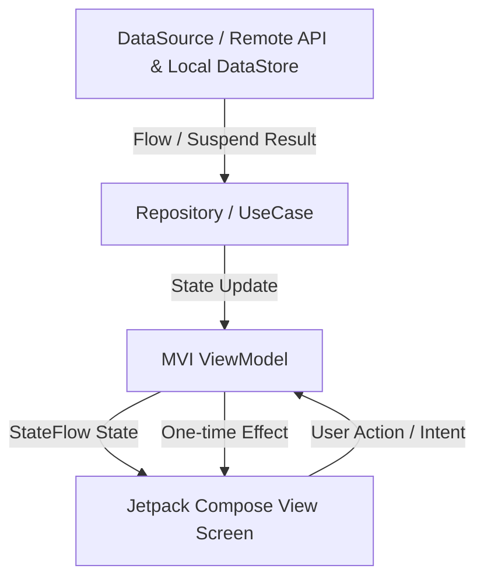

# NBSBanking - Android Architecture & Engineering Guide

Welcome to the **NBSBanking** codebase repository. This project is a modern, modular Android application built following Clean Architecture principles, MVVM/MVI design patterns, Jetpack Compose, and advanced enterprise security practices.

---

## 🛠 Tech Stack & Libraries
- **Language**: Kotlin 2.x
- **UI Framework**: Jetpack Compose & Material 3
- **Dependency Injection**: Dagger Hilt
- **Navigation**: Jetpack Navigation 3
- **Asynchronous Processing**: Kotlin Coroutines & Flow (Turbine for testing)
- **Serialization**: Kotlin Serialization (`kotlinx.serialization`)
- **Local Storage**: Jetpack DataStore (Preferences & Secured Preferences)
- **Database**: Room with SQLCipher (Encrypted SQLite)
- **Security**: Google Tink (`AndroidKeysetManager`) & Android Keystore
- **Firebase Services**: Firebase Messaging, Remote Config, Crashlytics, and Analytics

---

## 📦 Multi-Module Project Structure

The project is structured into modular Gradle sub-projects to enforce separation of concerns and build modularity:

| Module Path | Type | Description |
| :--- | :--- | :--- |
| `:app` | Android App | Application entry point (`BankingApp`), UI screens, feature navigation graphs, and Dashboard hub. |
| `:core` | Android Library | Core utilities, DataStore abstractions (`PreferenceDataStore`, `SecuredPreferenceDataStore`), encryption (`TinkEncryptor`), and EventBus. |
| `:coreDatabase` | Android Library | Room database, type converters, and SQLCipher encrypted database support. |
| `:coreNetwork` | Android Library | Retrofit client setup, OkHttp interceptors, SSL pinning, and network configurations. |
| `:membership` | Android Library | Authentication and membership feature flows (Login, Verification Success). |
| `:navigation` | Android Library | Jetpack Navigation 3 extensions, navigation data manager, and global navigation keys (`AppNavKey`). |
| `:components` | Android Library | Shared Jetpack Compose design system components and UI atoms. |
| `:buildLogic` | Non-Android | Custom Gradle convention plugins for feature modules, unit testing, and dependency management. |

---

## 🔄 MVI Architecture & Data Flow (DataSource to Screen)

The application follows the **MVI (Model-View-Intent)** architectural pattern combined with Clean Architecture principles. Data flows unidirectionally from persistence/network down to the UI, and user interactions flow up as intents.

### 1. DataSource Layer (Local & Remote)
- **Local Storage**:
  - `PreferenceDataStore` (standard typed preferences using Kotlin Serialization).
  - `SecuredPreferenceDataStore` (encrypted preferences backed by Google Tink & Android Keystore).
  - Room + SQLCipher (encrypted local database).
- **Remote Storage**: Retrofit API services communicating over secure OkHttp channels.
- Data sources emit reactive Kotlin `Flow` streams or suspend results.

### 2. Repository & UseCase
- Repositories abstract data sources, handling caching, decryption, and mapping raw DTOs / models to domain models.
- UseCases encapsulate specific business logic rules and orchestrate single-responsibility operations.

### 3. MVI ViewModel (`BaseMviViewModel`)
- **Intent**: User actions or lifecycle events are sent to the ViewModel via `onIntent(intent)`.
- **Model (State)**: The ViewModel processes intents on background dispatchers (`withIo`, `withDefault`), mutates domain/UI state, and exposes an immutable `StateFlow<UiState>` to the UI.
- **Effect**: One-time UI events (such as showing a Snackbar, navigation triggers, or Toasts) are emitted via a Kotlin `Channel` / `Flow` (`UiEffect`).

### 4. Jetpack Compose View (Screen)
- The Composable screen collects the `StateFlow<UiState>` using `collectAsStateWithLifecycle()` and renders UI declaratively.
- User interactions trigger callbacks that dispatch new `Intent` events back to the ViewModel.
- Side effects (`UiEffect`) are observed via `LaunchedEffect` to display snackbars or handle navigation.

---

## 🔒 Security & Encryption Architecture

### 1. Secured Preferences (`SecuredPreferenceDataStore`)
- Powered by **Google Tink** (`AES256_GCM` AEAD parameters).
- Backed by hardware-enforced **Android Keystore** via `AndroidKeysetManager`.
- Provides encrypted SharedPreferences/DataStore persistence with constant associated data.
- **Anti-Tamper Integrity**: Decryption failures (`GeneralSecurityException: decryption failed` wrapped in `DecryptDataException`) immediately throw security exceptions to prevent tampering and unauthorized access.

### 2. Encrypted Database (SQLCipher)
- SQLite database tables are encrypted at rest using **SQLCipher**.

---

## 💾 Data Management & Storage

### 1. `PreferenceDataStore`
- Typed DataStore preferences wrapper utilizing **Kotlin Serialization**.
- Supports type-safe object keys via `objectPreferencesKey(...)` returning `ObjectPreferenceKey<T>`.

### 2. `InMemoryStorage`
- Concurrent in-memory key-value store backed by `ConcurrentHashMap` and reactive `MutableSharedFlow` emitters for real-time observation.

---

## 🧭 Navigation (Jetpack Navigation 3)
- Built on **Jetpack Navigation 3** with serializable `AppNavKey` destination objects (`LaunchableDestination`, `NavigationDestination`).
- Centralized routing in feature modules (`appNavigation`, `membershipNavigation`, `dashboardNavigation`, `noteNavigation`, etc.).
- Post-login **Dashboard hub** acts as a container providing quick access to all core features (`HomeMvi`, `UserSettings`, `NavDemo`, `Note`, `RandomActivityIdea`).

---

## 🧪 Testing Strategy
- **Unit Tests**: JUnit4, Kotlin Coroutines Test (`runTest`, `UnconfinedTestDispatcher`), MockK, and Flow testing with Cash App **Turbine**.
- **Datastore Tests**: Isolated in-memory temporary file tests for both standard and secured preference data stores.
- **Encryption Tests**: Verified cryptographic round-trips using Tink AEAD primitives.

---

## 🚀 Getting Started
1. Open the project in **Android Studio**.
2. Sync project with Gradle files.
3. Run `:app:assembleDebug` or deploy to a connected Android device/emulator.
